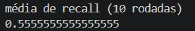

# 🍽️ PratoMatch — Sistema de Recomendação de Pratos Culinários

Sistema de recomendação de pratos culinários que combina o histórico de avaliações do usuário com suas preferências alimentares, categorias de interesse e alergias.

A aplicação é formada por:

- **Frontend:** React 19, React Router e Vite.
- **Backend:** Django 6.1 e Django REST Framework.
- **Banco de dados:** SQLite, usado pelo Django.
- **Recomendador:** filtragem baseada em conteúdo com TF-IDF, perfil do usuário e similaridade de cosseno.

> 🎥 **Vídeo de demonstração:** 

https://drive.google.com/drive/u/0/my-drive

---

## 1. Objetivo

O PratoMatch recomenda receitas personalizadas com base nas avaliações dos usuários e em suas preferências alimentares.

O sistema permite:

- cadastrar e autenticar usuários;
- consultar, pesquisar e filtrar pratos;
- visualizar detalhes, ingredientes, categorias e modo de preparo;
- avaliar pratos com notas de 1 a 5;
- favoritar pratos;
- consultar pratos avaliados e favoritados;
- configurar alergias, preferências alimentares e categorias de interesse;
- gerar recomendações personalizadas;
- recomendar pratos a usuários com pouco ou nenhum histórico usando os dados do onboarding.

---

## 2. Fundamentação

| **Conceito**                 | **Neste projeto**                                                                                       |
| ---------------------------- | -------------------------------------------------------------------------------------------------------- |
| **Filtragem baseada em conteúdo** | Cada prato é representado por TF-IDF dos ingredientes e comparado ao perfil do usuário.             |
| **Interação usuário × item** | Cada interação relaciona um usuário a um prato e registra uma nota de 1 a 5.                              |
| **Similaridade de cosseno**  | Mede a semelhança entre o vetor de preferência do usuário e cada prato candidato.                       |
| **Perfil do usuário**        | É a soma ponderada dos vetores dos pratos avaliados, considerando nota e tempo visualizado.             |
| **Conteúdo dos pratos**      | Ingredientes e categorias são usados na representação, filtragem e explicação das recomendações.       |
| **Sistema híbrido**          | O ranking de conteúdo recebe a influência das categorias escolhidas no onboarding.                       |
| **Cold start**               | O onboarding fornece pratos de interesse até que o usuário tenha histórico suficiente de avaliações.   |
| **Personalização**           | Pratos já avaliados são removidos e os candidatos são filtrados conforme as alergias cadastradas.       |

### 2.1 Filtragem baseada em conteúdo

Cada receita é transformada em um vetor TF-IDF a partir dos IDs de seus ingredientes.
O perfil do usuário é obtido pela soma desses vetores, ponderada pela diferença
entre a nota dada e a média das notas do próprio usuário. A similaridade de cosseno
entre o perfil e cada receita gera o ranking Top-N, excluindo os pratos já avaliados.

---

## 3. Dados

### 3.1 Fontes utilizadas

| **Dataset / Fonte**      | **Conteúdo**                                                               | **Uso no projeto**                 |
| ------------------------ | -------------------------------------------------------------------------- | ---------------------------------- |
| **RAW_recipes.csv**      | Nome, descrição, ingredientes, tags, tempo e passos das receitas           | Catálogo e detalhes dos pratos     |
| **RAW_interactions.csv** | Usuários, receitas, notas e datas das interações                           | Histórico e filtragem colaborativa |
| **PP_recipes.csv**       | Dados pré-processados das receitas                                         | Dataset auxiliar                   |
| **PP_users.csv**         | Dados pré-processados dos usuários                                         | Dataset auxiliar                   |
| **ingr_map.pkl**         | Mapeamento de ingredientes                                                  | Tratamento de alergias              |
| **interactions_*.csv**   | Divisões de treino, validação e teste                                       | Avaliação offline                  |

**Link da fonte principal:** <https://www.kaggle.com/datasets/shuyangli94/food-com-recipes-and-user-interactions>

### 3.2 Características dos dados

Os arquivos locais atualmente contêm:

- `RAW_recipes.csv`: **231.637** receitas;
- `RAW_interactions.csv`: **1.132.367** interações originais;
- `PP_recipes.csv`: **178.265** registros;
- `PP_users.csv`: **25.076** registros;
- `interactions_train.csv`: **698.901** registros;
- `interactions_validation.csv`: **7.023** registros;
- `interactions_test.csv`: **12.455** registros.

Os arquivos brutos são carregados diretamente pelo módulo de recomendação. Os arquivos de treino, validação e teste ficam disponíveis para avaliações offline.
O comando de avaliação usa somente treino para construir o perfil e teste para medir
as recomendações, com nota mínima 4 como critério de relevância.

### 3.3 Preparação dos dados

1. Os CSVs de receitas e interações são carregados com pandas.
2. Campos de tags, ingredientes e passos são convertidos de texto para listas.
3. As tags técnicas são removidas da lista de categorias exibida no sistema.
4. As avaliações são agrupadas por receita para calcular a média e a quantidade de avaliações.
5. Receitas e interações são relacionadas pelos IDs originais.
6. O script `backend/seed.py` popula o banco Django com categorias, pratos, usuários, interações e catálogos de alergias e preferências.

---

## 4. Método

### 4.1 Preparação para recomendação

```text
Dados das receitas e interações
              ↓
Limpeza e conversão dos campos
             ↓
Vetorização TF-IDF dos ingredientes
             ↓
Perfil de conteúdo do usuário
             ↓
Similaridade de cosseno perfil × prato
             ↓
Ranking Top-N
              ↓
Filtros de alergias e pratos já conhecidos
              ↓
Recomendações exibidas no frontend
```

### 4.2 Algoritmo de recomendação

**Algoritmo utilizado:** filtragem baseada em conteúdo, com TF-IDF e similaridade de cosseno.

Para cada usuário, o sistema:

1. transforma os ingredientes dos pratos em vetores TF-IDF;
2. constrói o perfil do usuário a partir dos pratos avaliados;
3. calcula a similaridade entre o perfil e todos os pratos;
4. prioriza as categorias selecionadas no onboarding;
5. remove pratos já avaliados;
6. retorna o ranking final.

Parâmetros principais:

| Parâmetro | Valor padrão | Descrição |
| --------- | ------------ | --------- |
| `N` | `24` na API / `5` e `10` na avaliação | Quantidade máxima de recomendações |
| `nota` | média individual do usuário | Peso da interação no perfil |
| `tempo_visualizado` | registrado em segundos | Ajuste do peso da interação |

### 4.3 Tratamento dos pratos já conhecidos

Os pratos que já aparecem no histórico de interações do usuário não entram no conjunto de recomendações.

### 4.4 Cold start

Quando o usuário possui menos de cinco pratos avaliados, os pratos selecionados como interessados no onboarding são usados como informação inicial do perfil. As preferências e alergias cadastradas também são aplicadas durante a filtragem.

### 4.5 Fluxo do usuário

1. O usuário realiza cadastro ou login.
2. No onboarding, seleciona preferências alimentares, alergias, categorias e pratos de interesse.
3. O sistema apresenta os pratos e recomendações.
4. O usuário pode pesquisar, filtrar, favoritar e avaliar pratos.
5. As avaliações são armazenadas no banco de dados.
6. Novas recomendações são geradas a partir do histórico atualizado.

---

## 5. Avaliação

### 5.1 Protocolo de avaliação

O projeto possui rotinas de avaliação offline em `backend/recomendacao/metricas/avaliar.py` e `backend/recomendacao/algoritmos.py`.

As divisões disponíveis são:

- `interactions_train.csv`;
- `interactions_validation.csv`;
- `interactions_test.csv`.

Para executar a avaliação com `K=5` e `K=10`:

```bash
cd backend
python -m recomendacao.metricas.avaliar --limite-usuarios 100
```

O resultado inclui o sistema e os baselines aleatório e popular, além de
Precision, Recall, nDCG e cobertura do catálogo. A semente do baseline aleatório
é fixa em `42`.

O módulo de métricas implementa `MRR@K` e a criação de ground truth a partir de interações com nota mínima. Os valores finais de avaliação devem ser preenchidos após a execução do experimento definido para o projeto.

Para demonstrar o cálculo em uma base separada, gere e avalie a base sintética:

```bash
cd backend
python seed_metricas.py
python -m recomendacao.metricas.avaliar_demo -k 5
```

Essa base fica em `backend/PratoMatch/db_metricas.sqlite3` e não altera o banco
da aplicação. Ela contém 50 usuários e 750 receitas; IDs e ingredientes vêm de
`PP_recipes.csv`, enquanto usuários e interações são sintéticos e criados para
a demonstração. Portanto, os resultados comprovam o funcionamento do cálculo,
mas não devem ser apresentados como desempenho real do recomendador.

### 5.2 Métricas

| **Métrica** | **Descrição** |
| ----------- | -------------- |
| **HITRATE@5** | Métrica que mede a porcentagem de vezes que uma tentativa, estratégia ou sistema atinge um resultado positivo ou esperado. |
| **REC@ALL@5** | Mede a proporção de casos positivos reais que um modelo de classificação conseguiu identificar corretamente |
| **PRECISION@5** | Métrica de avaliação em aprendizado de máquina que mede a proporção de previsões positivas corretas em relação ao total de previsões positivas feitas pelo modelo|
| **Ground truth por nota** | Considera relevantes as interações com nota maior ou igual ao limite configurado, que por padrão é 4. |

### 5.3 Exemplos de usuários

Os exemplos e resultados numéricos devem ser adicionados após a execução da avaliação experimental.

---

## 6. Resultados


## 7. Interface

O PratoMatch possui uma interface desenvolvida em React.

### 7.1 Página inicial

- Lista de pratos;
- recomendações;
- busca por nome;
- filtros alimentares.

### 7.2 Favoritos e avaliados

O usuário pode consultar os pratos favoritados e os pratos avaliados, incluindo sua nota.

### 7.3 Detalhes da receita

A tela de detalhes apresenta:

- nome, imagem e descrição;
- categorias e ingredientes;
- tempo de preparo;
- avaliação média e quantidade de avaliações;
- quantidade e descrição dos passos;
- opção de avaliar e favoritar.

### 7.4 Filtros

- Vegetariano;
- Vegano;
- Sem glúten;
- Sem lactose.

### 7.5 Cadastro e login

O cadastro utiliza nome de usuário e senha.

### 7.6 Onboarding

O onboarding possui três etapas:

1. seleção de alergias e preferências alimentares;
2. seleção de categorias preferidas;
3. seleção de pratos de interesse.

Na terceira etapa, os pratos são carregados pelo endpoint
`GET /onboarding/pratos/`. A resposta usa as receitas reais do dataset,
aplicando as alergias, a restrição alimentar e as categorias escolhidas antes
de intercalar os resultados para manter a diversidade. Os pratos selecionados
são persistidos no perfil e usados como avaliações iniciais de interesse pelo
recomendador durante o cold start.

### 7.7 Perfil do usuário

O perfil permite visualizar e alterar preferências e alergias, alterar a senha e excluir a conta.

**Tela inicial**


**Tela de Perfil do usuário**


**Tela de histórico**


**Tela de cadastro/onboarding**


---

## 8. Limitações

- O recomendador depende da qualidade e da cobertura dos ingredientes cadastrados.
- A representação atual usa IDs de ingredientes; ela não captura totalmente sinônimos,
  texto livre ou semântica culinária.
- O tratamento de alergias depende do mapeamento disponível em `ingr_map.pkl`.
- Os resultados experimentais ainda precisam ser documentados.
- O banco SQLite é adequado para desenvolvimento, mas não é a opção indicada para produção.

### Trabalhos futuros

- executar e documentar a avaliação offline;
- comparar o método atual com baselines;
- melhorar a recomendação baseada no conteúdo das receitas;
- adicionar paginação e cache para recomendações;
- preparar o sistema para implantação em produção.

---

## 9. Como executar

### Requisitos

- Python 3.14.7;
- Node.js v24.21.0;
- npm 11.19.0.

As versões das bibliotecas Python estão fixadas em `backend/requirements.txt`. As dependências do frontend estão em `frontend/PratoMatch/package.json`.

### Comando para executar

Na raiz do projeto:

```bash
python iniciar_pratomatch.py
```

O script cria ou reutiliza o ambiente virtual em `backend/venv`, instala as dependências e inicia o backend e o frontend.

Backend disponível em:

```text
http://127.0.0.1:8000
```

Frontend:

```text
http://localhost:5173
```

A porta exibida pelo Vite deve ser usada caso a porta padrão esteja ocupada.

### Popular o banco

Para aplicar as migrações e carregar os dados no banco:

```bash
cd backend
python seed.py
```

Para remover os dados criados pelo seed e carregá-los novamente:

```bash
python seed.py --limpar
```

---

## 10. Estrutura do projeto

```text
backend/
├── dataset/
├── PratoMatch/
│   ├── manage.py
│   ├── configs/
│   └── myapp/
├── recomendacao/
|   ├── metricas/
|   |   ├── avaliar.py
|   |   ├── baselines.py
|   |   ├── cobertura_catalogo.py
|   |   ├── nDCG.py
|   |   ├── precision.py
|   |   ├── recall.py
│   ├── algoritmos.py
│   ├── main.py
│   └── metricas.py
├── requirements.txt
└── seed.py

frontend/
└── PratoMatch/
    ├── src/
    │   ├── components/
    │   ├── hooks/
    │   ├── layouts/
    │   ├── pages/
    │   └── services/
    ├── public/
    ├── package.json
    └── vite.config.js

README.md
└── iniciar_pratomatch.py
```

---

## 11. Referências

- [Dataset Food.com Recipes and User Interactions](https://www.kaggle.com/datasets/shuyangli94/food-com-recipes-and-user-interactions)
- [Documentação do Django](https://docs.djangoproject.com/)
- [Documentação do Django REST Framework](https://www.django-rest-framework.org/)
- [Documentação do React](https://react.dev/)
- [Documentação do Vite](https://vite.dev/)

---


**Instituição:** UEA - Universidade Estadual do Amazonas
**Curso:** Sistemas de Informação
**Disciplina:** Oficina de Desenvolvimento de Sistema 1
**Professor:** Fábio
**Data:** 30/09/2026
